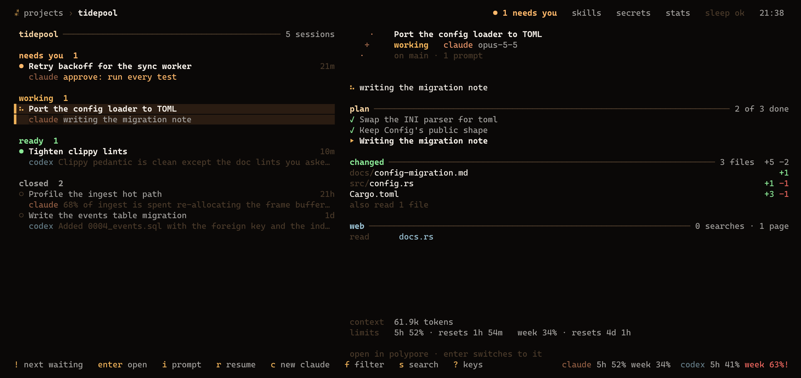
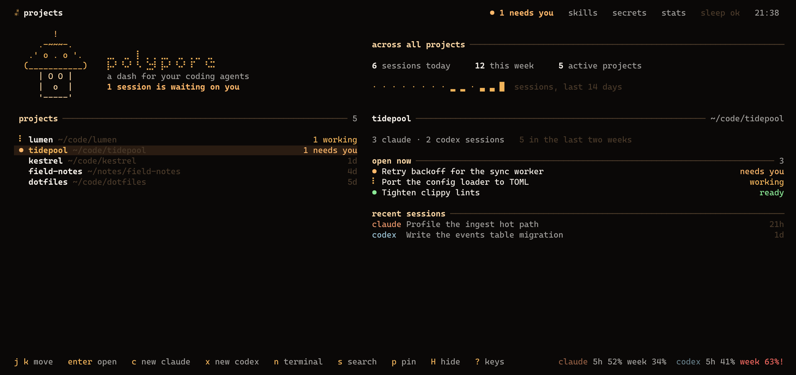
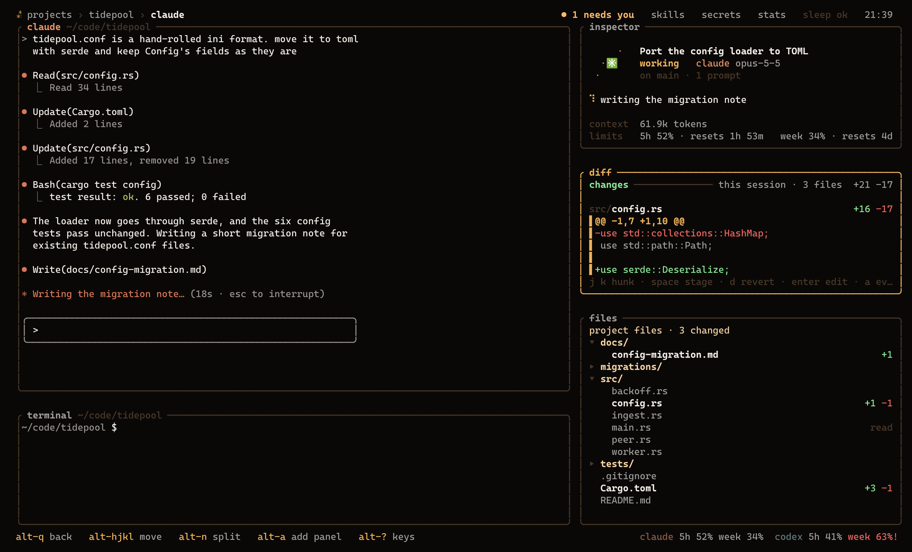
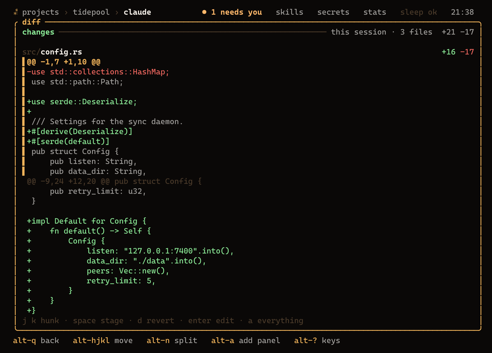

<div align="center">

# polypore

**A dashboard for the claude and codex sessions you already have.**

[](https://github.com/evanklem/polypore/releases/latest)
[](https://github.com/evanklem/polypore/actions/workflows/ci.yml)
[](LICENSE)

[Install](#install) · [How it works](#how-it-works) · [Working with sessions](#working-with-sessions) · [From a shell](#from-a-shell) · [Keys](#keys) · [Config](#config)



</div>

If you run claude and codex in a few terminals across a few projects, you know the routine. You tab around to find the one that is waiting on a permission prompt. You scroll back to see what it changed. You check whether you are about to hit the 5-hour limit. You forget which session was the one that fixed the login bug last Tuesday.

polypore is one terminal window that answers those questions. It reads what the CLIs already write to `~/.claude` and `~/.codex`, so it shows every session you have ever run, including the ones you started somewhere else, with no hooks to install. It also hosts real terminals, so claude, codex, nvim and your shell run unchanged inside it, and they keep running when polypore closes.

One binary, about 5 MB, written in Rust. Nothing is injected into the agents' context.

- **Every session, sorted by what it needs from you.** *Needs you*, *working*, *ready*, *closed*. States come from claude's own status file and codex's turn events, not from scraping the screen.
- **An inspector instead of scrollback.** Each session's plan, the files it changed, the commands that failed, the pages it read and its last reply.
- **Sessions outlive the dashboard.** A small background server owns the terminals. Quit, crash or close the window and everything is still there when you reopen it.
- **Prompt without attaching.** Type into a session from the list, queue a prompt for when its turn ends, or send the same prompt to several at once.
- **Review what the agent did.** Stage, unstage or revert its changes hunk by hunk, or have a clean-context reviewer read the diff.
- **Hand off.** Fork a session, or start a fresh one from a written note of the goal, plan and open problems, in the same agent or the other one when you are near a limit.
- **Limits that are never stale.** claude's and codex's 5-hour and weekly windows, when they reset, and whether you will run out first at your current pace.
- **Secrets the agents can use but not read.** `.env` values move into the OS keyring; agents get placeholders and a small MCP server that runs commands with the real values and masks the output.
- **Scriptable.** `polypore ls --json`, `send`, `watch`, and shell hooks when a session needs you.

## Install

Linux and macOS.

```sh
curl -fsSL https://raw.githubusercontent.com/evanklem/polypore/main/install.sh | sh
```

This puts `polypore` in `~/.local/bin` (set `POLYPORE_INSTALL_DIR` to change it). Prebuilt binaries for x86_64 and arm64 are also on the [releases page](https://github.com/evanklem/polypore/releases).

With a Rust toolchain:

```sh
cargo install --git https://github.com/evanklem/polypore --locked
```

Or from a clone: `cargo build --release`, then copy `target/release/polypore` somewhere on your `PATH`. Building on Linux needs `libdbus-1-dev` and `pkg-config` (for the keyring).

Then run `polypore`. `polypore doctor` lists what it can see on this machine: the claude and codex folders, live sessions, the terminal server, the keyring.

You need [claude](https://docs.claude.com/en/docs/claude-code) or [codex](https://github.com/openai/codex) (or both). `git` is used for worktrees and hunk review, `curl` for claude's limits.

## How it works

Three levels, like a file browser: **projects → sessions → a session**. Every level is a list on the left and the selection's details on the right. `enter` goes in, `h`/`esc` (or `alt-q` inside a session) comes back.

**Projects** are every folder claude or codex has worked in, found from their history. The right side shows what is open there now and the recent sessions. The mushroom reflects your agents: blinking when all is quiet, happy while they work, alarmed when one needs you.



**Sessions** are one project's sessions, grouped by what they need from you, like Claude's agent view: *needs you*, *working*, *ready* (your turn), *terminals*, *closed*. The right side shows the selected session's plan, what it changed, what failed, what it read on the web, its last reply and its context use.

**A session** is the real terminal (claude, codex or a shell) with the inspector and a file tree beside it, tiled like Hyprland. The file tree is the project with what the agent touched marked and unfolded: `j`/`k` move, `enter` opens a folder or opens a file in `$EDITOR` beside the terminal, `h` folds, `a` switches between touched files and the whole project. Closed sessions open read-only; `r` resumes them.



States come from the agents themselves: claude publishes `busy` / `idle` / `waiting` for live sessions, codex from its turn events. Context shows as tokens for claude (it does not record its window size; set `context_window` to get a gauge) and as a percentage for codex.

Secondary screens, top right: **skills**, **secrets**, **stats**.

### Sessions keep running

Terminals live in a small background server (`polypore server`, started on its own by the dashboard), so closing or crashing polypore leaves claude, codex and your shells running. Reopening picks every one of them up where it was, screen included. Closing a session (`d` on the list, `alt-W` inside it) stops it; quitting polypore does not. On a claude background job (`claude --bg`), `d` runs `claude stop` and `r` opens it with `claude attach`. A session running in some other terminal opens read-only, since two copies of one agent would write over each other's transcript; quit it there to resume it here. The server exits a minute after its last terminal does. `[server] enabled = false` puts the terminals back inside the dashboard, closing with it.

## Working with sessions

On the session list:

- `i` types a prompt into a session without opening it. A session that is mid-turn gets it when the turn ends; a closed one is resumed in the background with it. Mark several with `space` to send the same prompt to all of them.
- `!` goes to the next session waiting for you, across projects; press it again for the one after.
- `f` steps through what the list shows: everything, needs you, working, ready, closed, archived.
- `s` searches every transcript in every project: titles, your prompts, the replies and the files touched. `enter` opens a result, `ctrl-r` resumes it.
- `F` forks a session (same history, a new session); `>` hands it off: polypore writes down the goal, plan, changed files and open problems, and a fresh session starts from that note.
- `<` is quota failover: the same handoff as `>`, into the other agent. When claude or codex gets near a limit, polypore says so once and the session's details offer it.
- `w` / `W` start claude / codex on a new branch in its own git worktree. Closing that session asks whether to merge the branch into the one it came from, keep it, or delete it.
- `R` has a clean-context reviewer (`[review] command`, `claude -p --no-session-persistence` by default, so reviews do not show up as sessions) read the session's uncommitted changes. Its findings show in the inspector and in a review panel beside the session.
- `D` opens the session's changes as hunks: `j`/`k` move, `space` stages or unstages, `d` reverts, `enter` opens your editor at that line, `a` switches between the session's files and everything uncommitted.
- `e` renames a session, `A` archives it (out of the list until `f` reaches "archived"). Names and archive marks stay in polypore; the agents' files are never rewritten.
- `y` then a letter copies: `r` the resume command, `i` the id, `c` the folder, `t` the title, `l` the last reply, `f` the changed files, `p` the plan. It goes through OSC 52, so it works over ssh (and in tmux with `set-clipboard on`).
- `:` opens a command line with completion (`alt-:` inside a session): `:resume`, `:prompt …`, `:theme gruvbox`, `:filter needs-you`, `:yank files`, `:worktree codex fix-login`, `:layout save`, `:project casita`. Tab lists every command.



Launch presets are named ways to start a session. With any for an agent, `c` or `x` asks which one to start:

```toml
[[presets]]                     # in config.toml, or <project>/.polypore/presets.toml
name = "plan first"
agent = "claude"
args = "--permission-mode plan" # added after the agent command
prompt = "read the README, then propose a plan"
worktree = false                # true: asks for a branch and starts in its own worktree
project = ""                    # a folder or project name; empty means every project
```

## From a shell

```sh
polypore ls                      # open sessions: state, agent, id, project, title
polypore ls --all --json         # everything, for scripts and status bars
polypore send 0fa2 "run the tests again"   # an id prefix; waits for the current turn to end
polypore send pane-3 -           # the prompt from stdin, into polypore terminal 3
polypore watch --json            # one line per state change; --hooks runs [hooks]
```

`send` types into sessions running in polypore terminals; a closed session is resumed in a new polypore terminal with the prompt, and the dashboard picks it up. Sessions running in some other terminal can't be typed into.

`[hooks]` runs a shell command when a session needs you, finishes a turn, or starts working, with `POLYPORE_STATE`, `POLYPORE_AGENT`, `POLYPORE_SESSION`, `POLYPORE_PROJECT`, `POLYPORE_TITLE` and `POLYPORE_TEXT` set:

```toml
[hooks]
on_needs_you = 'notify-send -u critical "$POLYPORE_AGENT needs you" "$POLYPORE_TEXT"'
on_done = 'paplay /usr/share/sounds/freedesktop/stereo/complete.oga'
```

## Limits

The footer and the inspector show claude's and codex's 5-hour and weekly limits, with when they reset and, once enough of a window has passed, whether it runs out first at the current pace (marked `!`). Each comes from the freshest source: codex's own rollouts, Omarchy's usage records, or for claude Anthropic's usage endpoint asked with claude's own login (`[quota] claude_probe`, at most every five minutes, token passed to curl on stdin). A window that has reset is never shown.

## Keys

The footer always shows the few keys that matter on the current screen; `?` shows all of them.

Lists: `j`/`k` move, `g`/`G` top and bottom, `enter` open, `esc` back, `/` filter, `s` search everything, `c`/`x`/`n` new claude/codex/terminal, `r` resume, `!` next session waiting for you, `S` stay awake, `T` next theme, `q` quit. Sessions: `i` prompt, `f` status filter, `space` mark, `e` rename, `A` archive, `F` fork, `>` hand off, `<` hand off to the other agent, `y` copy, `w`/`W` worktree session, `R` review, `D` hunks, `d` close. `:` command line. Projects: `p` pin, `H` hide, `a` add a folder (missing folders are created; `Dev/x` means `~/Dev/x`), `.` show hidden. Skills: `s` link all, `a` adopt, `n` new, `e` edit, `d` drop a broken link, `r` refresh. Stats: `r` refresh, `m` ask a model, `o` open the report. Settings that change the machine or the look take a capital letter so they never flip by accident.

Inside a session every key goes to the terminal except **alt** combinations:

| | |
|---|---|
| `alt-q` | back to the session list |
| `alt-h/j/k/l`, `alt-arrows` | move between panes |
| `alt-H/J/K/L` | swap panes |
| `alt-shift-arrows` | move the divider that way |
| `alt-n` `alt-c` `alt-x` | split in a terminal, claude, codex |
| `alt-a` | add a panel |
| `alt-w` / `alt-W` | close the pane / the whole session |
| `alt-z` `alt-o` | zoom, switch the split between side by side and stacked |
| `alt-pgup` `alt-pgdn` | previous / next open session |
| `alt-g` `alt-s` `alt-?` | what needs you, stay awake, all keys |

Nothing inside a session uses a plain key or a ctrl key, so claude's and codex's own shortcuts (esc, ctrl-r, shift-tab, `/` commands, alt-p, alt-t) all keep working.

Left alone on purpose: `alt-b/f/d/.` (shell word editing) and `alt-p`/`alt-t` (claude's model picker and thinking toggle). On macOS set your terminal's option key to send alt. Prefer tmux style? `[keys] mode = "prefix"` makes it `ctrl-space` then a key.

Mouse: click to select, click again to open, drag the gaps to resize, drag a pane title onto another pane to swap.

## Config

`~/.config/polypore/config.toml` is written on first run with comments. The app never rewrites it except the `theme` line when you press `T`.

```toml
[ui]
theme = "auto"         # auto: your desktop colors (Omarchy) when readable, else polypore
                       # polypore (honey on brown), system, terminal (16 ANSI colors),
                       # catppuccin gruvbox tokyonight nord rose-pine everforest kanagawa mono
border = "rounded"     # rounded plain thick double none
gaps = 1
transparent = true     # leave the background to the terminal (blur, wallpaper)

[keys]
mode = "alt"           # or "prefix" (ctrl-space, then a key)

[agents.claude]
command = "claude"
animation = "spark"    # spark orbit pulse bars wave dna prompt dots moon, or your own

[colors]               # override any role: fg dim faint accent accent2 ok warn err info claude codex shell sel bg
accent = "#89b4fa"
```

Colors: `theme = "auto"` follows your desktop palette on Omarchy (it reads the active theme's `colors.toml` and updates when you switch themes) and falls back to `polypore`, the original honey-on-brown palette. Any single color can be overridden under `[colors]`.

Animations: drop `~/.config/polypore/anims/<name>.txt` with frames separated by a line holding `---` (optional first line `fps: 8`) and set `animation = "<name>"`. They play only while that agent is working.

Layouts: `~/.config/polypore/layouts/default.toml` is the session template (agent over a terminal, with the inspector, activity feed and file tree beside them). Rearranging an agent session saves a per-project copy next to it. `:layout default` inside a session makes its layout the template for every project, `:layout save` for its project only, `:layout reset` drops the project's copy. Panels you can add with `alt-a`: inspector, tasks, files, activity, web, commands, subagents, usage, errors, diff, review.

## Stay awake

`S` (or `alt-s` in a session) keeps the machine awake while agents work. The choice is remembered: polypore turns it back on every time it opens, until you switch it off. The lock itself only lives while polypore runs, so a closed or crashed polypore never pins the machine. On Linux it holds a `systemd-inhibit` lock (`[sleep] what` picks what to block); on Omarchy it also flips the shell's stay-awake flag, because Omarchy 4.5 idles from its shell and ignores systemd inhibitors, then restores whatever it was before. macOS uses `caffeinate -w`.

## Secrets

- `i` on the secrets screen moves a project's `.env` values into the OS keyring and comments the lines out.
- Your own shells in polypore, and `polypore run -- cmd` anywhere, get the values injected.
- Agent terminals start with every secret name replaced by a `polypore-secret://NAME` placeholder.
- `w` wires a project: Claude deny rules for `.env*`, `polypore run` and `secret-tool`; the `polypore-secrets` MCP server in `.mcp.json` (and `codex mcp add`); a skill; one line in CLAUDE.md/AGENTS.md.
- Agents call `secrets_exec` (argv, no shell) or `secrets_http` (`{{NAME}}` placeholders). Each new command pattern or host asks you in the attention strip: once, always, or deny. Commands that can print their environment are refused. Output is masked, including base64, hex and URL-encoded forms.

Any process running as you can read the OS keyring, so this is a guard rail against agents leaking secrets by accident, not a sandbox.

## Skills and analysis

The skills screen keeps one folder of skills linked into both `~/.claude/skills` and `~/.codex/skills`, and flags broken links, duplicates and leftovers.

The stats screen scans the last 30 days locally. `m` sends a compact extract (your prompts, errors, loops; about 120 KB) to `[analysis] command` (`claude -p` by default, on your subscription) and asks what you keep correcting, where agents waste time, and what to add to CLAUDE.md or write as skills. The report lands in `~/.local/state/polypore/analysis/` and in `[analysis] wiki` when that folder exists.

## Data sources

All read-only and undocumented, so every parser ignores what it does not recognise. When a CLI update changes its format, a view may come up empty until polypore catches up; `polypore doctor` shows what it can still read.

- claude: `~/.claude/projects/*/*.jsonl` transcripts, `~/.claude/sessions/<pid>.json` live status, `~/.claude/jobs` and `daemon/roster.json` for background sessions
- codex: `~/.codex/sessions/**/rollout-*.jsonl` (both the app-server item records and the older event records), `session_index.jsonl` for titles; rate limits come from its token events

## Alternatives

If all your sessions are claude, Claude Code's own [agent view](https://code.claude.com/docs/en/agent-view) (`claude agents`) covers the session list. [agent-deck](https://github.com/asheshgoplani/agent-deck), [claude-squad](https://github.com/smtg-ai/claude-squad), [agent-of-empires](https://github.com/agent-of-empires/agent-of-empires) and [ccmanager](https://github.com/kbwo/ccmanager) manage sessions they launch, mostly on top of tmux, and support more agents than polypore does. polypore covers claude and codex only. In exchange it reads their history and status files directly, hosts its own terminals, and shows each session's plan, changes and problems.

## Code

```
src/sources/   claude + codex adapters into one AgentRun model (model.rs)
src/store.rs   index, live discovery, incremental parsing on a worker thread
src/pane.rs    pty + vt100 emulation, terminal query replies, OSC notify/clipboard/cwd
src/server.rs  the background terminal server and its client (unix socket)
src/cli.rs     ls / send / watch, the state tracker, [hooks]
src/keys.rs    key and mouse encoding (xterm + kitty)
src/layout.rs  tiling tree, toml layouts
src/app.rs     state, events, actions        src/ui.rs  drawing
src/secrets.rs src/mcp.rs  broker + MCP server
src/quota.rs   src/search.rs  src/hunks.rs  src/review.rs  src/handoff.rs  src/worktree.rs  src/meta.rs
src/skills.rs  src/analysis.rs  src/sleep.rs  src/notify.rs  src/theme.rs  src/anim.rs
```

`cargo test` covers the layout tree, key/mouse encoding, masking, allowlists, both parsers, the tail reader, quota sources and pace, hunk parsing with staging and reverting in a real repo, search ranking, agent launch commands, the state tracker, handoff notes and server frames.

polypore started as a Tauri desktop IDE; that version is kept at the [`v0-tauri`](https://github.com/evanklem/polypore/tree/v0-tauri) tag.

## License

MIT
